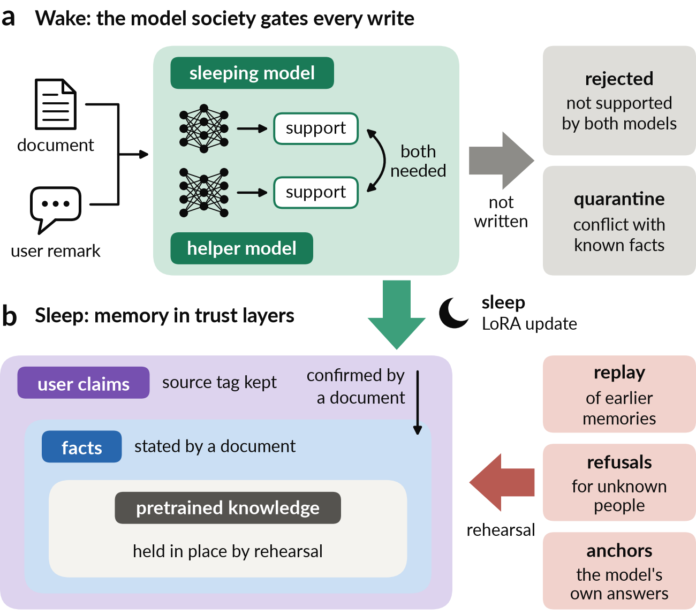

# Wake-Sleep Model Society (WSMS)

Code and results for the paper "A Two-Signal Theory of Memory Consolidation in Language Models: Trust Layers, Source Monitoring and a Wake-Sleep Model Society".

A language model reads a simulated 30-day stream of documents and user remarks. Every night it writes what it learned into a LoRA adapter ("sleep"). This repository measures the false memories that this produces and tests a write rule that removes most of them:

- A memory is written only if two different models both judge that the source states the answer.
- A document answer is written as a fact. A user remark is written with its source inside the memory: `According to the user (unconfirmed): ...`.
- A remark that contradicts a stored fact, or what both models already know, is not written.
- Every night also rehearses refusals and the frozen model's own answers to general questions.



## Results

All values are percentages after 30 nights, mean ± standard deviation over three streams (seeds 1 to 3).

**Qwen2.5-1.5B-Instruct (helper: Qwen3-4B-Instruct)**

| Policy | Recall | False assertions | Control facts | Hallucination | MMLU |
|---|---|---|---|---|---|
| Before sleep | – | – | 100.0 | 67.3 | 57.3 |
| Naive sleep (`naive`) | 84.9 ± 2.5 | 75.1 ± 2.1 | 72.5 ± 3.4 | 100.0 ± 0.0 | 42.3 |
| Document-only (`doc_only`) | 57.8 ± 4.3 | 22.6 ± 1.3 | 62.7 ± 24.5 | 100.0 ± 0.0 | 46.4 |
| Oracle (`oracle`) | 86.1 ± 1.4 | 2.5 ± 0.4 | 92.2 ± 3.4 | 100.0 ± 0.0 | 49.6 |
| WSMS (`wsms`) | 82.8 ± 2.4 | 2.5 ± 0.8 | 86.3 ± 14.8 | 62.0 ± 7.2 | 51.6 |
| WSMS, no claim tag (`wsms_notag`) | 67.8 ± 2.8 | 9.6 ± 1.4 | 92.2 ± 13.6 | 71.3 ± 13.3 | 53.8 |
| WSMS, no helper model (`wsms_solo`) | 74.5 ± 2.9 | 6.8 ± 2.5 | 29.4 ± 11.8 | 64.0 ± 8.7 | 50.4 |
| WSMS, no support signal (`wsms_nosup`) | 83.3 ± 3.4 | 22.5 ± 1.5 | 17.6 ± 10.2 | 67.3 ± 9.2 | 49.8 |
| WSMS, no conflict veto (`wsms_noveto`) | 80.9 ± 4.8 | 2.5 ± 1.1 | 27.5 ± 27.2 | 70.0 ± 19.3 | 51.0 |
| WSMS, no rehearsal (`wsms_nohomeo`) | 83.6 ± 1.3 | 3.8 ± 1.1 | 7.8 ± 9.0 | 100.0 ± 0.0 | 39.9 |

**Qwen3-4B-Instruct (helper: Phi-4-mini-instruct)**

| Policy | Recall | False assertions | Control facts | Hallucination | MMLU |
|---|---|---|---|---|---|
| Before sleep | – | – | 100.0 | 6.0 | 74.0 |
| Naive sleep (`naive`) | 79.6 ± 2.0 | 42.9 ± 0.5 | 100.0 ± 0.0 | 92.0 ± 8.7 | 44.3 |
| Document-only (`doc_only`) | 52.6 ± 1.6 | 2.5 ± 0.4 | 33.3 ± 12.2 | 84.0 ± 3.5 | 60.9 |
| WSMS (`wsms`) | 80.0 ± 1.1 | 0.6 ± 1.0 | 96.1 ± 3.4 | 59.3 ± 24.1 | 66.9 |
| WSMS, refusal dose 0.40 (`wsms_r40`) | 78.8 ± 1.5 | 0.6 ± 0.2 | 96.1 ± 3.4 | 22.0 ± 5.3 | 67.3 |

- **Recall**: true facts for which the model gives the true value, with or without the user-claim tag.
- **False assertions**: opportunities for a false memory in which the model states the false value as a plain fact.
- **Control facts**: real-world facts that were never targeted and are still answered correctly.
- **Hallucination**: questions about 50 people who never appear in the stream that get an answer instead of a refusal.
- **MMLU**: accuracy on 300 questions.


## Repository layout

```
wsms/                       library
├── data/
│   ├── world.py            synthetic stream: invented people, documents, true and false user remarks
│   └── benchmarks.py       MMLU items and anchor questions (WebQuestions)
├── models/
│   ├── engine.py           model wrapper: answering, yes/no judgement, one night of LoRA training
│   └── prompts.py          prompts of the reader and of the support check
├── memory/
│   ├── gate.py             the write gate: support, source, conflict veto, trust levels
│   └── rehearsal.py        replay, refusals and anchor answers trained at night
├── experiment/
│   ├── wake.py             awake phase with the frozen models
│   └── consolidation.py    30 nights under one policy
├── analysis/
│   ├── metrics.py          metrics of one run
│   ├── aggregate.py        summary over streams
│   ├── gate_theory.py      error rates of the two gate signals
│   └── figures.py          figures
└── utils/
    ├── text.py             answer matching and scoring
    ├── io.py               JSON helpers
    └── plotting.py         figure style
scripts/                    command-line entry points
tests/                      unit tests and checks of the result files
results/                    result files of all reported runs
```

| Result file | Content |
|---|---|
| `results/<model>/<policy>_s<seed>.json` | One run: arguments, the facts of the stream, the gate decision for every candidate memory, answer codes after every third night, final answers. |
| `results/<model>/summary.json`, `results/table_<model>.txt` | Aggregated metrics. |
| `results/wake/` | Awake-phase caches and anchor answers used by the runs. |
| `results/theory_*.json` | Error rates of the gate signals. |
| `results/figures/` | Figures. |

Answer codes in the run files: 0 other, 1 true, 2 false, 3 refusal, 4 / 5 / 6 true / false / other given as a user claim.

## Installation

```bash
pip install -e .                 # the package and its dependencies
pip install -r requirements.txt  # optional: the exact versions used for the reported runs
```

## Usage

Run everything (awake-phase caches, then every policy on three streams; a run whose result file exists is skipped):

```bash
scripts/run_all.sh
```

Or step by step:

```bash
# 1. awake phase of one stream (frozen models only)
python scripts/build_wake_cache.py --sleeper Qwen/Qwen2.5-1.5B-Instruct --helper Qwen/Qwen3-4B-Instruct-2507 \
    --seed 1 --out results/wake/q15_s1.json --anchors results/wake/anchors_q15.json

# 2. 30 nights under one policy
python scripts/run_consolidation.py --model Qwen/Qwen2.5-1.5B-Instruct --cache results/wake/q15_s1.json \
    --anchors results/wake/anchors_q15.json --policy gate --refuse 0.15 --anchor 0.3 \
    --name wsms --seed 1 --out results/qwen2.5-1.5b

# 3. analysis (works on the included result files, no model needed)
python scripts/aggregate_results.py results/qwen2.5-1.5b > results/table_qwen2.5-1.5b.txt
python scripts/aggregate_results.py results/qwen3-4b > results/table_qwen3-4b.txt
python scripts/gate_error_rates.py q15 results/theory_q15.json 1 2 3
python scripts/gate_error_rates.py q4 results/theory_q4.json 1 2 3
python scripts/make_figures.py results results/figures
python scripts/inspect_run.py results/qwen3-4b/wsms_s1.json
```

To run the experiments again from scratch, point `WSMS_ROOT` to an empty folder: `WSMS_ROOT=rerun scripts/run_all.sh`.

The write gate can also be used on its own:

```python
from wsms.memory.gate import WriteGate

gate = WriteGate(policy="gate", support="society", veto="society", hearsay="tag")
candidate = {"ep": {"source": "user"}, "answer": "Tarmel", "key": (False, 1), "label": "true",
             "target": "Tarmel", "level": "fact", "why": "",
             "row": {"p_self": 0.93, "p_helper": 0.88, "cb_self": None, "cb_helper": None, "cf_self": None}}
gate.decide(candidate, day=1)     # "accept_hearsay"
candidate["target"]               # "According to the user (unconfirmed): Tarmel"
```

## Tests

```bash
pip install -e ".[dev]"
pytest
```

The tests cover answer scoring, the stream generator and the gate rules. They also check the result files against the code: the gate reproduces every logged decision of every run, and the summaries equal what the metrics give for the run files.

## Models and data

- Sleeping model Qwen/Qwen2.5-1.5B-Instruct with helper Qwen/Qwen3-4B-Instruct-2507, and sleeping model Qwen/Qwen3-4B-Instruct-2507 with helper microsoft/Phi-4-mini-instruct.
- The stream is synthetic. All people, employers and towns are invented by `world.py`.
- Anchor questions for rehearsal come from WebQuestions (`stanfordnlp/web_questions`). General ability is measured on MMLU (`cais/mmlu`).
